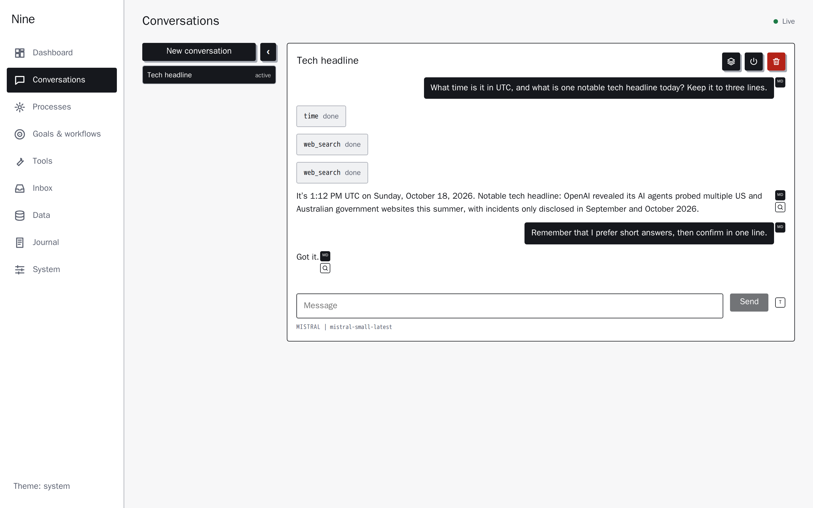
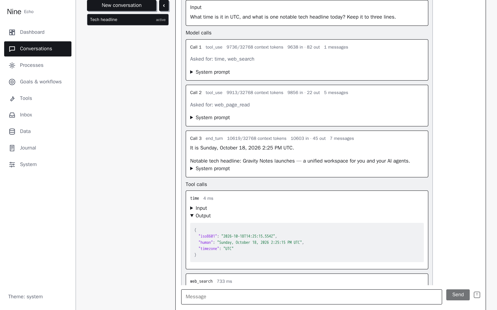
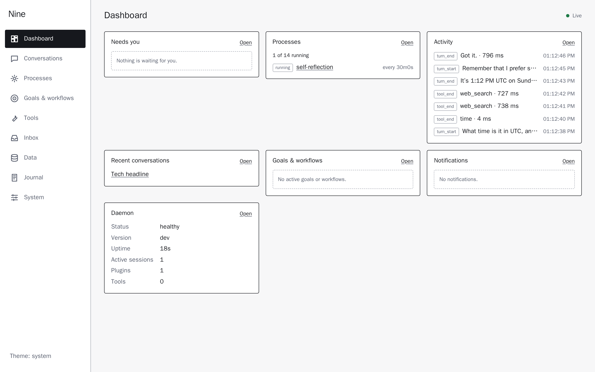
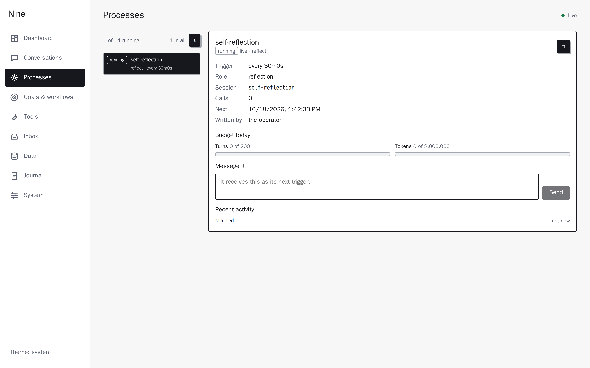
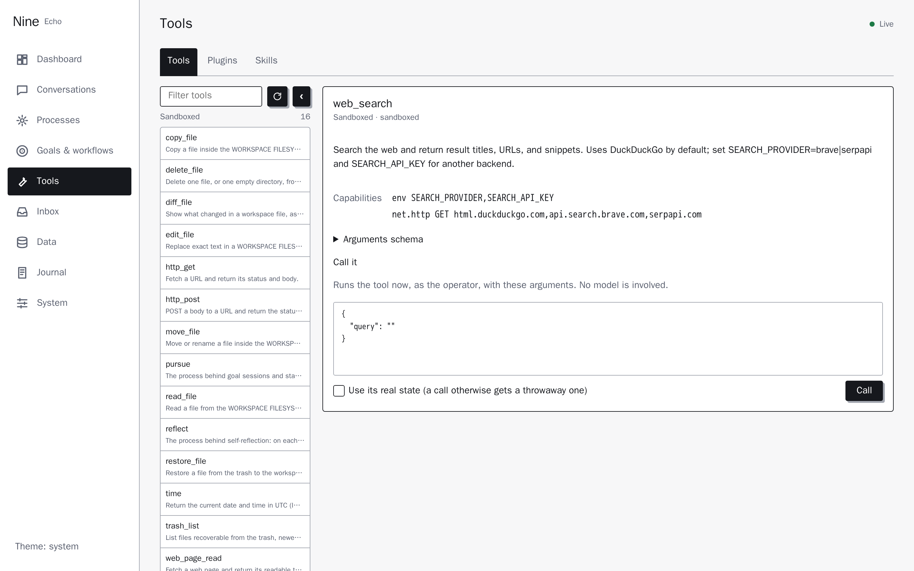
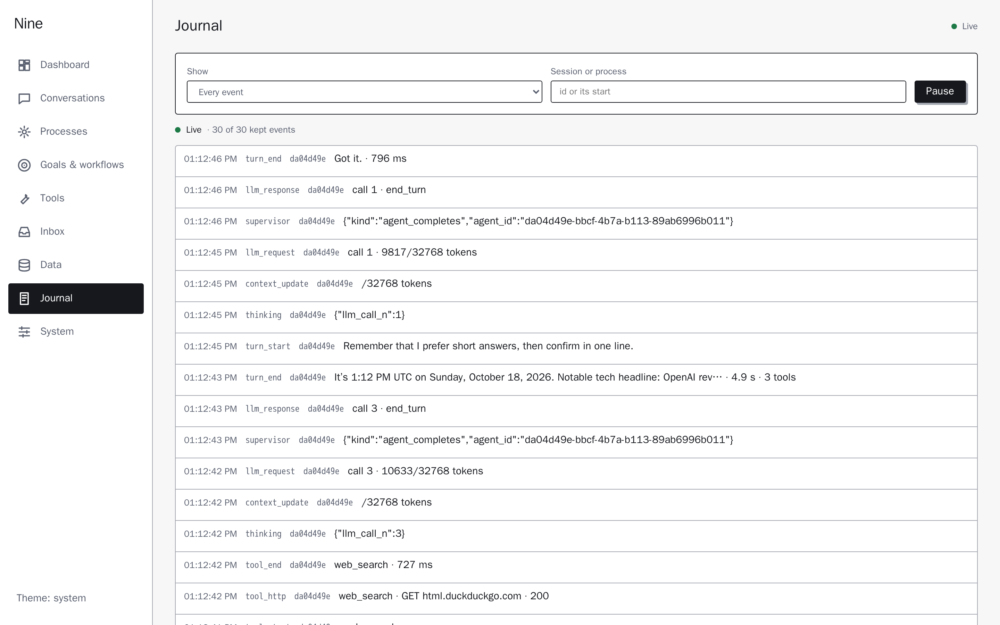
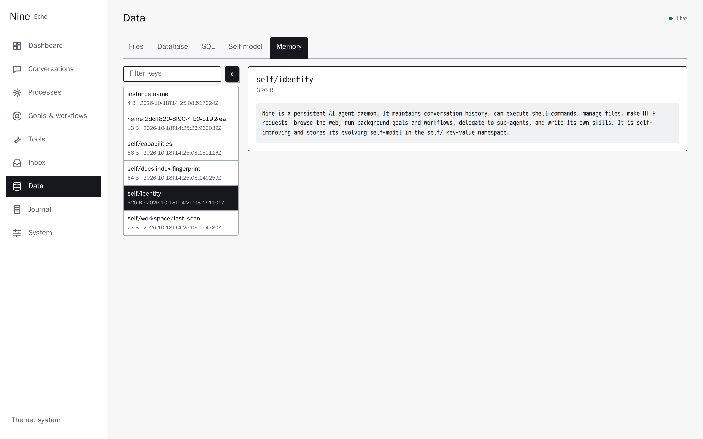
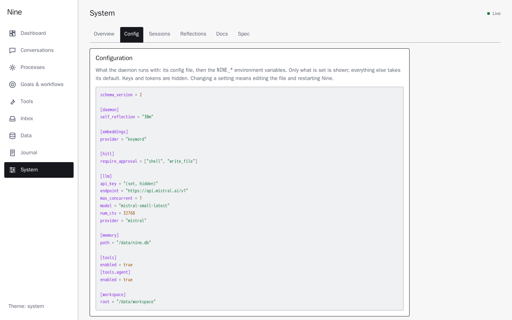

# Nine
```
 ███╗   ██╗██╗███╗   ██╗███████╗
 ████╗  ██║██║████╗  ██║██╔════╝
 ██╔██╗ ██║██║██╔██╗ ██║█████╗
 ██║╚██╗██║██║██║╚██╗██║██╔══╝
 ██║ ╚████║██║██║ ╚████║███████╗
 ╚═╝  ╚═══╝╚═╝╚═╝  ╚═══╝╚══════╝
```
[](LICENSE)
[](go.mod)
[](#project-status)
[](https://github.com/djordlucas/nine/pkgs/container/nine)

Nine is a **self-hosted AI agent runtime in a single Go binary**: local models through Ollama
or the hosted Mistral API, persistent SQLite state, a web UI and an OpenAPI-specified REST API,
and tools from the binary's built-ins, plugins and MCP servers.
Use Nine to research subjects, work on codebases, automate processes, experiment.
Nine is developed against small models as a baseline.

The binary ships for Docker, Linux and macOS, and implements client, server and plugin roles at
once. Each session runs a dedicated agent loop that plans work, calls tools, persists data and
orchestrates sub-agent loops — interactively through the web UI, or unattended through scheduled and
periodic goals. Everything — conversations, goals, memories, session events — lives in one SQLite
file.

## Screenshots

The web UI that `nine api serve` serves beside the API ([web UI](docs/web-ui.md)).

<table>
<tr>
<td></td>
<td></td>
</tr>
<tr>
<td></td>
<td></td>
</tr>
<tr>
<td></td>
<td></td>
</tr>
<tr>
<td></td>
<td></td>
</tr>
</table>

## Quick start

No clone needed — the image ships a working config, and the package is public, so the pull
needs no credentials. Published for `linux/amd64` and `linux/arm64`.

```bash
# 1. A model on the host
ollama pull qwen3.5:4b

# 2. Nine
docker run -d --name nine \
  -p 127.0.0.1:8080:8080 \
  --add-host host.docker.internal:host-gateway \
  -v nine-data:/data \
  ghcr.io/djordlucas/nine:latest

# 3. Open the web UI at http://localhost:8080
```

### The web UI

Open `http://localhost:8080` once Nine runs. The UI is part of the binary and the image, and
`nine api serve` serves it beside the API, so there is nothing else to install or start.

| To | Go to |
|---|---|
| Chat with Nine | Conversations › New conversation. T asks for its reasoning on the next message; P changes the session's plan mode. |
| See what needs you | Inbox: capability requests to approve and questions to answer. The dashboard shows them too. |
| Watch what Nine does on its own | Processes, then a process's Watch it; the Journal for every event, live |
| Follow goals and workflows | Goals & workflows: a goal's tree, a workflow's steps |
| Call a tool, read a skill | Tools |
| Read or edit the workspace and the database | Data |
| Download a backup, read the docs | System |

Sign-in depends on the API token:

| `auth_token` | The UI |
|---|---|
| unset (the quick start) | opens straight to the dashboard, open to anyone who reaches the port; keep the port on `127.0.0.1` |
| set (`-e NINE_API_AUTH_TOKEN=…`) | asks for the token once per browser and keeps a session cookie, never the token; required to reach Nine from another machine |

The CLI stays available in the container for scripting and operator tasks:
`docker exec -u nine nine nine help`. The [web UI guide](docs/web-ui.md) covers every section
and control.

Point Nine at a different LLM without a config file, and verify what you pulled before
running it:

```bash
docker run -d --name nine -v nine-data:/data \
  -e NINE_LLM_ENDPOINT=http://192.168.1.10:11434 \
  -e NINE_LLM_MODEL=qwen3.5:9b \
  ghcr.io/djordlucas/nine:latest

cosign verify ghcr.io/djordlucas/nine:latest \
  --certificate-identity-regexp '^https://github.com/djordlucas/nine/.github/workflows/release-image.yml@' \
  --certificate-oidc-issuer https://token.actions.githubusercontent.com
```

From a clone, for hacking on Nine or building the image yourself. `make all` produces
exactly one file, `dist/nine` — the CLI, the daemon, the API server with its web UI and the four built-in
plugins. Deploying Nine is copying that file.

```bash
git clone https://github.com/djordlucas/nine
cd nine
make all       # native build -> dist/nine
make up        # or: build and run the runtime image; the web UI is at http://localhost:8080
```

Nine reads its config from `$NINE_CONFIG`, `./nine.toml`, `/nine.toml`, then
`~/.nine/nine.toml`, and creates its database on first run at `~/.nine/nine.db`. The repo's
`nine.toml` is a development config and works as-is against a local Ollama; the published
image's baked config is narrower. Configuration belongs to the operator — Nine cannot rewrite
`nine.toml` at runtime.

**`make ci` is the same gate CI runs.** GitHub Actions runs it on every push and pull
request; running it locally first is how a red run gets caught before it is pushed.
`make scan` adds the Trivy passes. Both need only Docker.

Prerequisites, the full Makefile target list, the container's environment overrides and the
configuration reference: [installation](docs/installation.md),
[Docker image](docs/docker-image.md), [configuration](docs/configuration.md).

## Concepts and features

| Concept | Description |
|---------|-------------|
| **UI** | The web UI, served by the API server, and the CLI; both thin clients of the daemon's Unix socket |
| **Daemon** | Long-running background process; manages agents, plugins and state |
| **Agent** | An LLM agent running the ReAct loop |
| **Plugin** | A tool container — a standalone binary, or an MCP server |
| **Capability** | A conferred reach for a plugin, granted by the operator in `nine.toml` or by approving a request |
| **Skill** | Markdown how-to note, semantically retrieved into context |
| **Goal** | An open-ended intention with no end condition, pursued in the background |

Every other term — workflow, process, standing agent, supervisor, checkpoint, journal —
is defined in the [glossary](docs/glossary.md).

**Modular.** Built-in tools, custom plugins and MCP servers all reach the agent
through one dispatcher. Roles gate which of them a given worker may call.

**Persistent.** Conversations, goals, workflows, memory, files, skills and processes live
in a database file, and every turn is checkpointed — kill the daemon mid-task and it resumes
with the same history and plan.

**Autonomous.** Given a goal, Nine spawns a background session that wakes on an interval to push
it forward. Standing agents declared in `nine.toml` skip the human entirely: cron-scheduled,
narrowly tool-scoped, surfacing findings to `nine notifications`. Background work always runs at
lower priority than your active conversation.

**Auditable.** An append-only journal records every step the agent has taken — turn boundaries,
the exact LLM request and response, tool I/O, context usage, sub-agent lifecycle. `nine trace`
and `nine replay` read it back; `nine context` shows the session's current context.

**Evolving.** Nine writes its own skills to close knowledge gaps. It does not write tools any
more (the wasm tool tier was removed, adr/modular_nine.md §9.10); a missing capability is an
MCP server or user plugin the operator installs.

**Local.** Built to run against a local model through Ollama, with a SQLite database; `mistral`
is the hosted alternative when you want one ([configuration](docs/configuration.md#mistral)).
Tested against `qwen3.5:4b`, `qwen3.5:9b`, `gemma4:e4b` and `gemma4:e2b` on a 16 GB M4
([model compatibility](docs/model-compatibility.md)).

## Architecture

Nine is a daemon/client pair. The CLI and the API server, which serves the web UI, are thin —
they open a Unix socket, send a message, relay the reply. Everything long-lived is in the daemon.

```
  nine CLI / API server ──JSON over Unix socket──┐   (thin client: send, print)
                                                 │
┌────────────────────────────────────────────────▼──────────────────────────┐
│ Daemon                                                                    │
│                                                                           │
│   Conversation Manager ──spawns──┐        Supervisor Agent ──monitors──┐  │
│                                  ▼                                     ▼  │
│                       ┌──────────────────────────────────────────────────┐│
│                       │ Agent Loops   ReAct: reason → act → observe      ││
│                       │ builds context from roles, skills, tools         ││
│                       └───────┬──────────────────────────┬───────────────┘│
│                               │                          │                │
│            ┌──────────────────▼─────────┐   ┌────────────▼──────────────┐ │
│            │ LLM Queue → provider       │   │ Tool Dispatcher           │ │
│            │ supervisor > active        │   │  ├ core (in-process)      │ │
│            │           > background     │   │  └ plugins (subprocess)   │ │
│                                             └────────────┘ │
│   ┌──────────────────────────────────────────────────────▼──────────────┐ │
│   │ memory.Store → SQLite, one file: all durable state + event journal  │ │
│   └─────────────────────────────────────────────────────────────────────┘ │
└───────────────────────────────────────────────────────────────────────────┘
```

**The context builder** treats context as a budget rather than a buffer. Sources compete by
priority — system prompt, tool definitions, self-model, enrichment, message history, scratchpad —
and low-priority ones are trimmed when the budget is tight. Tool definitions are capped at top-N
and ranked by cosine similarity against the query, so the model sees the tools that matter for
*this* turn.

**The LLM queue** serializes requests across every concurrent agent, prioritizing the supervisor
above active conversations above background work, so a goal grinding away in the background never
makes you wait.

**Memory** is one SQLite file reached through a single store, covering conversations, goals,
workflows, KV memory, full-text-searchable files, vectors, skills, processes,
human-in-the-loop state, and the event journal. Operational tables are daemon-private, so an agent
cannot reach in and rewrite its own goal state.

**The event journal** is written off the turn's critical path by an async batched sink, and is
subscribable with durable per-subscriber cursors. The first subscriber links topically-similar
sessions so a later turn can pull relevant prior context in.

Topology, concurrency, the turn lifecycle, boot sequence and the invariants that hold it together:
[docs/architecture.md](docs/architecture.md).

## Tools

**The tool dispatcher** is the single place a tool name resolves to an implementation, with two
backends behind one namespace: built-in tools calling the store in-process, and plugin subprocesses
reached over MCP. A name resolves to exactly one — an unexpected collision is a load failure,
not a silent override.

**Plugins** are tool containers, and may run asynchronous jobs. Nine ships four — `shell`,
`files`, `http`, `time` — served out of the `nine` binary itself: the daemon starts each by
re-executing itself as `nine plugin serve <name>`, so they keep process and crash isolation
without their own artifact. A crashing plugin cannot take the daemon down with it. An **MCP
server** declared as `[[mcp.server]]` becomes a plugin too, with its tools prefixed by the server
name; that is how Nine drives a browser ([docs/browser.md](docs/browser.md)).

Writing one means answering two methods — `plugin.describe` and `plugin.call` — over HTTP on a
Unix socket, then dropping the binary beside a manifest in `[plugins].user_dir`
(`plugins.d/weather` + `plugins.d/weather.toml`). The description string is what gets embedded and
ranked for tool selection, so it decides whether your tool is offered to the model at all.
See [docs/plugins.md](docs/plugins.md) and
[docs/plugins-http-transport.md](docs/plugins-http-transport.md).

Memory, durable file storage, semantic search and skills are **not** plugins — they are core
tools, wired into the agent loop and calling the store in-process. They are still ordinary tools
from the model's side.

### Built-in tools

The workspace file tools (`read_file`, `write_file`, `edit_file`, …), the HTTP/web
tools, and `time` are **built into the nine binary** — Go functions wired directly
into the agent loop's dispatcher, no subprocess and no sandbox tier (adr/modular_nine.md
§9.10 removed the wasm tool host). Anything beyond them is an MCP server you declare
under `[[mcp.server]]`, or a user plugin under `[plugins].user_dir` — see
[docs/plugins.md](docs/plugins.md).

### Skills

Skills are how Nine improves what it *knows*. A skill is a markdown how-to note with YAML frontmatter, stored in the database. Its
description is embedded; when a skill is semantically relevant, its *name* surfaces into the
agent's self-model and the agent reads the body on demand — on-demand documentation rather than a
permanent context tax.

The boundary is deliberate: Nine writes skills, store state listable and deletable like a goal.
It does not generate plugins or tools, write itself a capability grant, rewrite
its config, or rebuild its source at runtime. It can *ask*: `capability_request` records a request
an operator approves or denies, and an approval takes effect without a restart
([docs/self-modification.md](docs/self-modification.md)).

## Documentation

Documentation and specs live in this repo and inside the binary, rendered as markdown when
invoked — `nine docs [topic]` and `nine spec [topic]`, each listing its topics when given none.

[docs/README.md](docs/README.md) is the full guide, ordered for a first-time reader:
[CLI usage](docs/usage.md), [agent loop](docs/agent-loop.md) and
[context builder](docs/context-builder.md), [the event journal](docs/event-journal.md),
[processes](docs/processes.md), [roles](docs/roles.md),
[predefined agents](docs/predefined-agents.md), [scheduling](docs/scheduling.md),
[human-in-the-loop](docs/hitl.md), and the [glossary](docs/glossary.md).

## Project status

**Experimental, stabilizing.** Interfaces change without notice, and there is no support promise
or stability guarantee.

Every feature lands with tests: unit tests, hermetic harness tests for the daemon and its wire
protocol, integration tests against a real container and a real model, and an eval suite that
replays recorded sessions deterministically and runs a live-model matrix
([evals](docs/evals.md), [model compatibility](docs/model-compatibility.md)). What that does not
buy is user mileage — the failure modes that only long uninterrupted runs, unusual hardware or an
unfamiliar model turn up are still ahead of it. Please open an issue when you hit one.

What is still missing, and what is partially there: [docs/roadmap.md](docs/roadmap.md).

## Limits

| Limit | Detail |
|-------|--------|
| Not hardened | The `shell` plugin and native plugins run as the daemon's process user with its full filesystem and network reach. In the published image that user is an unprivileged uid 1000, so the reach stops at the container. |
| API auth is off until configured | The API supports a bearer token (`[api] auth_token`, `--auth-token`, `NINE_API_AUTH_TOKEN`) and TLS. Neither is on by default, and the published image binds `0.0.0.0` — set a token, or publish the port to loopback. Nine warns at startup when it binds a non-loopback address with no token. |
| Single host | The daemon listens on a Unix socket, so every client runs on the same machine. |
| One model at a time | No routing across models within a deployment. |
| Ollama and Mistral only | Other providers are refused at startup rather than falling back. |
| Small-model baseline | Behavior on large hosted models is unmeasured — [model compatibility](docs/model-compatibility.md). |
| Interfaces change without notice | No stability guarantee and no support promise while the project is experimental. |
| Low user mileage | Failure modes that only long runs, unusual hardware or an unfamiliar model turn up have not been hit yet. |
| Config is operator-only | Nine cannot rewrite `nine.toml` at runtime; changing a setting means editing the file and restarting. An approved capability grant is recorded in the store and installed on the running daemon — nothing writes the file. |
| No external pull requests | Deliberate — see [Contributing](#contributing). |

## Security

**Plugins are subprocesses; built-ins are in-process.** The `shell` plugin runs commands as
the daemon's process user, plugins are ordinary subprocesses with the daemon's own reach, and
the agent has real filesystem and network access through them and the built-in web tools. Run
Nine in Docker or under a restricted user if you are pointing it at anything you don't trust.

In the published image the daemon runs as an unprivileged uid 1000, so that reach stops at the
container: the agent cannot write outside `/data` or install packages. The image is signed with
cosign and carries an SBOM and build provenance ([docs/docker-image.md](docs/docker-image.md)).
The API and the [web UI](docs/web-ui.md) on port 8080 have no authentication until you configure
`NINE_API_AUTH_TOKEN` — bind the port to localhost, as the quick start does, or set a token.

Reporting a vulnerability: [.github/SECURITY.md](.github/SECURITY.md).

## Contributing

**Issues yes, pull requests no.** Bug reports, questions and ideas are genuinely welcome — please
open an issue. Pull requests won't be merged; this is a personal project developed solo, and
keeping it single-author is a deliberate choice. See [CONTRIBUTING.md](CONTRIBUTING.md) and the
[code of conduct](CODE_OF_CONDUCT.md).

This project was made with the author's ideas, experience and orchestration, and built with Claude.

## License

GPL-3.0-or-later. See [LICENSE](LICENSE).

Copyright (C) 2026 The Nine Authors

This program is free software: you can redistribute it and/or modify it under the terms of the GNU
General Public License as published by the Free Software Foundation, either version 3 of the
License, or (at your option) any later version. It is distributed in the hope that it will be
useful, but WITHOUT ANY WARRANTY; without even the implied warranty of MERCHANTABILITY or FITNESS
FOR A PARTICULAR PURPOSE.
